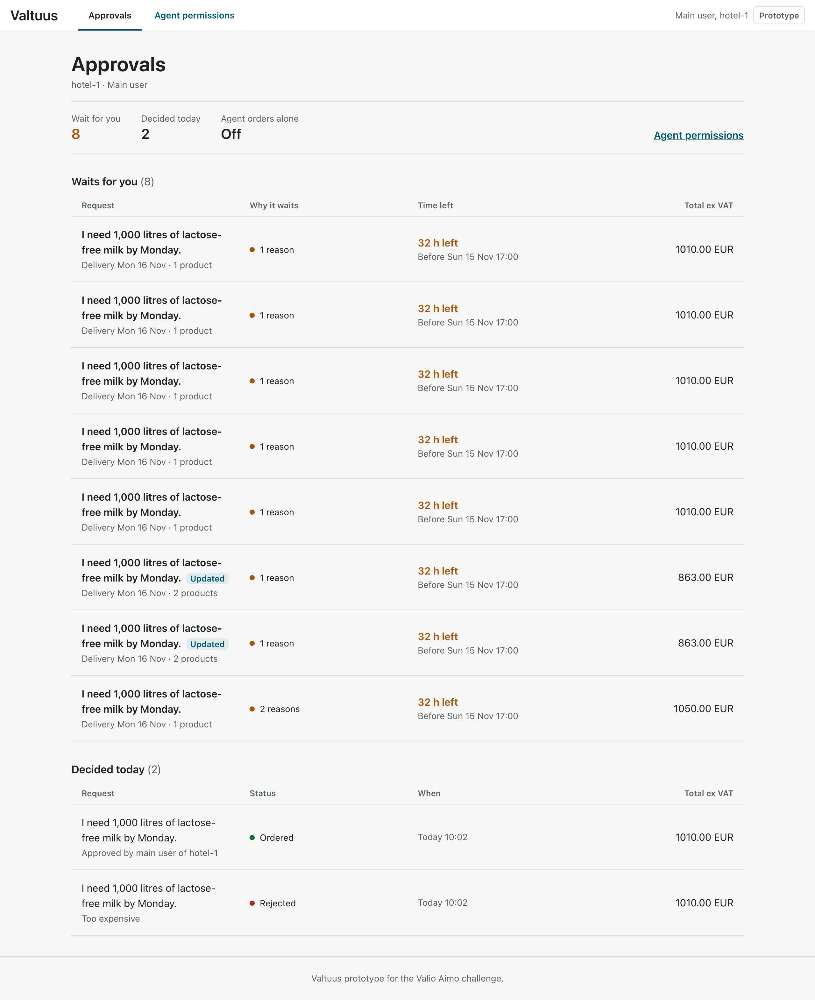
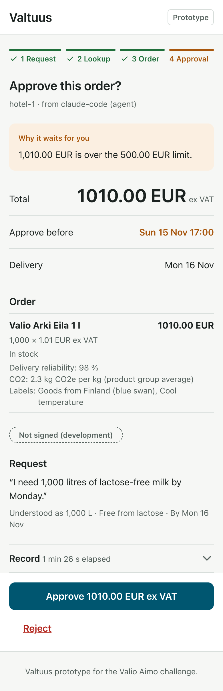
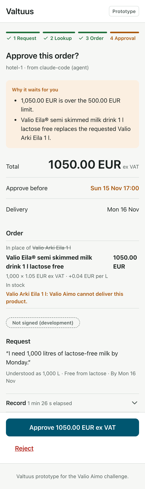
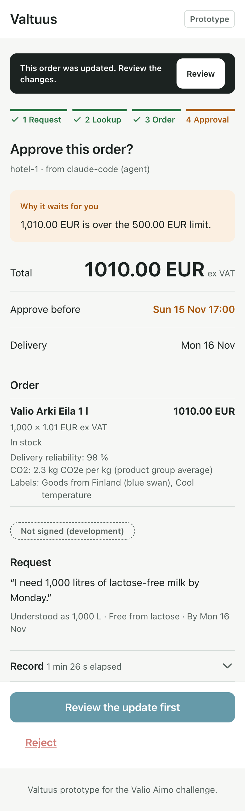
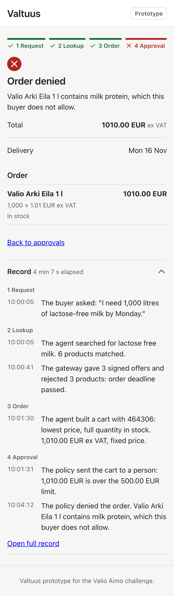
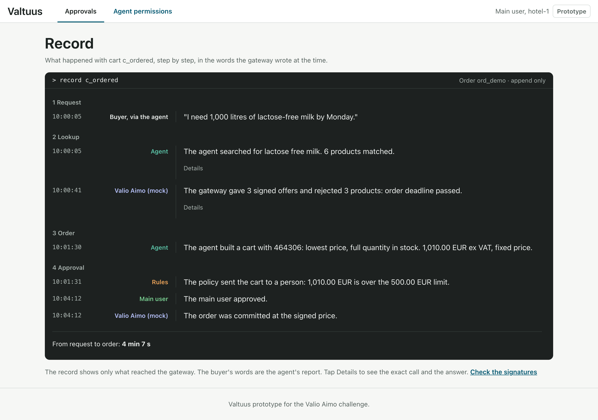
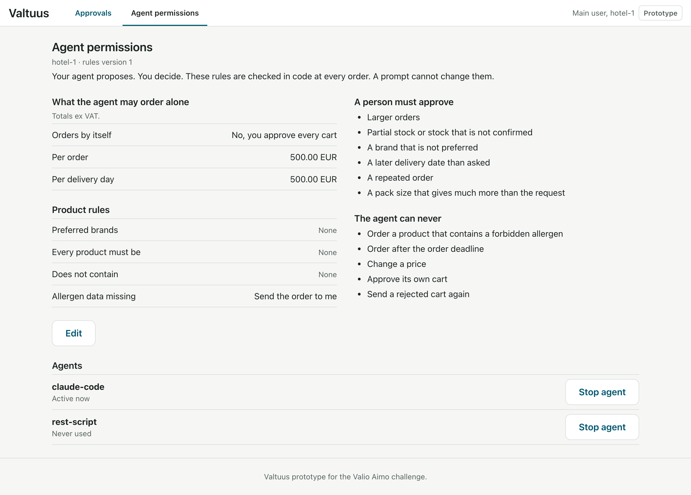

# Valtuus

A trust gateway that lets AI purchasing agents order from a food wholesaler. The agent asks, code
decides, and a person approves when the rules say so. Every price is signed and every step is
logged.

Built at Junction 2026 for the Valio Aimo "Trusted Trade Agents" challenge.

**Status:** the event is over. The Valio Aimo challenge mock APIs have been offline since
Junction, so the live agent flow can no longer get prices or stock. The
[screenshots](#screenshots) show the real UI in its fixture mode, which runs with no backend.

## The problem

Professional kitchens are starting to let AI agents do their purchasing. A wholesaler that accepts
those orders has to answer three questions:

1. How does the agent find the right product at a price it can rely on?
2. What may the agent order alone, and what needs a person?
3. After the fact, how do both sides prove who decided what, and why?

Valtuus answers them with a gateway on the seller side. The agent never touches the webshop or the
backend, and it sees only what its key allows.

## At a glance

| What                                     | How much                         |
| ---------------------------------------- | -------------------------------- |
| Pull requests merged during the event    | 123                              |
| Automated tests                          | 1,395 backend, 14 frontend       |
| Products the agent can search            | 17,546                           |
| Agent tools over MCP                     | 12, plus the same flow over REST |
| Reason codes, each with a plain sentence | 32                               |
| Language model calls in a decision       | 0                                |

## The demo, as a story

A hotel kitchen manager talks to a Claude Code agent that runs our purchasing skill.

1. **"1,000 litres of lactose free milk for Tuesday."** The agent searches, gets ranked offers
   with a reason for each product it rejects, and builds a cart. The total is over the auto limit,
   so the manager gets an approval link, approves on the phone, and a signed order comes back.
2. **"20 litres."** The same milk, inside the limit and inside the usual quantity. The agent orders
   alone, with no person involved.
3. **"Valio Eila for Monday."** The order deadline has passed. The agent refuses and says what can
   still arrive.
4. **"800 litres."** Over the limit again. The manager raises the limit, and checkout goes through
   under mandate version 2. The audit shows which version allowed it.

## Screenshots

From the frontend's fixture mode (`VITE_USE_FIXTURES=true`). Fixture data is not signed, so the
trust mark shows "Not signed (development)" where the live system shows a verified signature.

**Approvals inbox.** Every cart that waits for the manager, with the reason and the time left.



**Approval on a phone.** The first cart waits because it is over the limit. The second waits
because the agent offered a substitute. The third shows that the agent changed the cart, so the
manager must review the change before approval.

<p>
  
  
  
</p>

**A denied order.** The product contains an allergen that the buyer does not allow. The record
under it shows each step with its time.



**The record.** What happened to one order, in the words the gateway wrote at the time.



**Agent permissions.** The limits, the product rules, what always needs a person, and the agents
with a stop button for each.



## What we built

**Agent interface**

* MCP server at `/api/mcp` for AI agents and a REST API at `/api/v1` for other systems. Both call
  the same services, so the rules cannot differ between them.
* A per agent key with scopes. An agent key can never approve, reject or change the rules.
* `wait_for_decision` holds the call until a person decides, so the agent needs no timer.
* Errors always have the shape `{error, message, next_step}`, and the agent follows `next_step`.
  A line with no quantity gets `NEEDS_CLARIFICATION`, so the agent asks instead of guessing.
* A `valio-purchasing` skill that teaches Claude Code the flow.

**Catalog and offers**

* Search over 17,546 products by name, category and GS1 attributes (claims, allergens). When the
  top categories are close, the gateway asks the buyer instead of guessing.
* Offers from the Valio Aimo price and stock APIs, with retry, backoff and a cache. Each offer has
  a fixed price, an expiry time, the stock at a stated time and the order deadline.
* Trading rules: sales units, lot sizes, sales blocks, passed deadlines and stock that nobody has
  confirmed.
* Ranking by stock first, then the buyer's preferred brands, then the buyer's own weights for
  price, delivery reliability and CO2. Missing data shows as "no data", never as 0.
* Substitutes for rejected products, offered only when the allergen data matches in full. A cart
  with a substitute always waits for a person.
* A proposed split when one product is short on stock.

**Decisions**

* A policy engine of small, pure checks. Each cart gets AUTO, HUMAN or DENY with reason codes.
* The mandate: automatic orders on or off, a limit per order, a daily limit per delivery date,
  required attributes and forbidden allergens. Every change makes a new version.
* A confirmed envelope: the agent orders alone only products that a person approved before, in a
  usual quantity. A new product or an unusual quantity goes to a person.
* A line that repeats a recent order waits for a person, and a cart the manager rejected before
  is denied.

**Human approval**

* An approval page made for phones: the request, each line with its stock, price and offer facts,
  and why the cart waits.
* Cart revisions on the same link. An approval of an old revision gets 409 and places no order.
* An "Agent permissions" page: the automatic order switch, the limits, the agent list with last
  use, and revoke. A revoked key gets 401 at once.

**Trust and audit**

* Offers and order confirmations are signed with Ed25519 (JWS). The keys are public at
  `/.well-known/jwks.json`, and `POST /api/v1/verify` checks a signed document. The UI shows the
  result as a trust mark.
* The agent cannot send a price, a stock value or a date. The gateway reads them from its own
  signed offer, so the buyer pays what the agent was quoted.
* An audit record in plain language for every step and every refusal: who, when, why and under
  which mandate version. The buyer and the seller read the same record.
* Idempotency keys on cart creation and checkout, so a retry never makes a second order.

**Engineering**

* Clean architecture: `domain` <- `services` <- `adapters` and `api`, with the direction pinned by
  tests.
* PostgreSQL with Alembic migrations, plus in-memory adapters for fast tests.
* Money as exact decimals, never floats.
* Every merge to `main` runs lint, tests and type checks, builds images and deploys to one VM.
  An unhealthy deploy rolls back to the last good image.

## How it works

```
buyer --> buyer agent --(MCP or REST)--> Valtuus gateway --> Valio Aimo APIs
                                              |
                                  search, offers, cart
                                              |
                                  policy engine (no LLM)
                                              |
                    +-------------------------+-------------------------+
                    |                         |                         |
                  AUTO                      HUMAN                     DENY
           agent checks out        main user approves or        ended, with the
                    |               rejects on the approval        reason codes
                    |               page (human session)
                    +-------------------------+
                                              |
                        signed order confirmation + audit record
```

1. **Lookup.** The agent searches the catalog and gets offers: a fixed price for the price period
   and the stock at a stated time.
2. **Cart.** The agent creates a cart from offer IDs. It cannot send a price, a stock value or a
   date. The gateway reads them from its own stored offer.
3. **Decision.** The policy engine checks the cart against the buyer's mandate (spend limits,
   required attributes, forbidden allergens, deadlines) and returns AUTO, HUMAN or DENY. The
   decision is plain code with unit tests.
4. **Order.** Inside its authority the agent checks out. Outside it, only a person can approve,
   on the approval page. Words in the agent's chat are never an approval.
5. **Record.** Every step writes an audit record that both sides can read.

The cart states, and who is bound to what, are in [docs/INTERACTION.md](docs/INTERACTION.md).

## Connect your agent

| What          | Where                                                                |
| ------------- | -------------------------------------------------------------------- |
| MCP URL       | `https://junction.anvik.fi/api/mcp/`                                 |
| REST base URL | `https://junction.anvik.fi/api/v1`                                   |
| API docs      | https://junction.anvik.fi/api/docs and `/api/openapi.json`, no login |

The main user gives each agent its own key. Send it on every call, on MCP and REST:

```
Authorization: Bearer <agent key>
```

An agent key cannot approve or reject a cart, and cannot change the mandate. Only a person can.

For Claude Code, put this in `.mcp.json` and set `AGENT_KEY` in your shell, so the key is never
in the file:

```json
{
  "mcpServers": {
    "valtuus": {
      "type": "http",
      "url": "https://junction.anvik.fi/api/mcp/",
      "headers": {
        "Authorization": "Bearer ${AGENT_KEY}"
      }
    }
  }
}
```

Make the 4 calls in this order. REST paths are relative to the base URL.

| Step | MCP tool          | REST call                        | Result                             |
| ---- | ----------------- | -------------------------------- | ---------------------------------- |
| 1    | `search_products` | `GET /catalog/search?query=...`  | Product IDs. No price, no stock.   |
| 2    | `get_offers`      | `POST /offers`                   | Offer IDs, price and stock.        |
| 3    | `create_cart`     | `POST /carts`                    | The decision: AUTO, HUMAN or DENY. |
| 4    | `checkout`        | `POST /carts/{cart_id}/checkout` | Order confirmation. AUTO only.     |

* **Before step 1:** read the buyer's rules with `get_mandate` (`GET /mandate`).
* **HUMAN:** give the main user the cart's `approve_url`. Call `wait_for_decision`
  (`GET /carts/{cart_id}/wait`) with the revision of your last read. It returns when the cart
  changes, or after a hold with the cart still pending: then call it again.
* **DENY:** stop. `reason_sentences` tell the buyer why.
* **Changes:** `revise_cart` (`POST /carts/{cart_id}/revisions`) replaces the lines of an AUTO or
  PENDING_APPROVAL cart and runs the policy again. `withdraw_cart`
  (`POST /carts/{cart_id}/withdraw`) ends a cart that the buyer no longer wants.
* **Retries:** `create_cart` and `checkout` need an idempotency key (the `Idempotency-Key`
  header on REST, the `idempotency_key` argument on MCP). Send the same key again on a retry.
* **Errors:** every error has the body `{error, message, next_step}`. Follow `next_step`. A cart line with no `qty` also gets `reason_code: NEEDS_CLARIFICATION` and `missing`: ask the buyer, do not guess.

## Stack

Python 3.12, FastAPI, MCP, PostgreSQL 17, React 19, TypeScript, Caddy, Docker Compose and GitHub
Actions. The buyer agent is Claude Code with our `valio-purchasing` skill.

## Honest limits

This is a prototype. There is no real Valio Aimo order API, the stock is a snapshot, prices are
EUR ex VAT and there is one approver per buyer. The full list, and the known trust limits, are in
[docs/ASSUMPTIONS.md](docs/ASSUMPTIONS.md). What comes next, and the path to AP2, is in
[docs/NEXT_STEPS.md](docs/NEXT_STEPS.md).

## Open standards

* MCP for agents, REST described in OpenAPI 3.1 for other systems.
* JSON-RPC 2.0, ISO 8601 times and EUR amounts as exact decimals.
* JWS and JWKS for signatures.
* Our mandate, approval and order model is close to AP2 and UCP, but we don't claim compliance.

## Quick start

Needs `uv`, Node 22 and Docker.

```sh
git clone https://github.com/anvikx/valtuus.git
cd valtuus
cp .env.example .env
make setup
make up
```

Open http://localhost. To run the parts on their own with reload, use `make dev-be` and
`make dev-fe`.

### Commands

| Command       | What it does                                         |
| ------------- | ---------------------------------------------------- |
| `make setup`  | Install backend and frontend deps                    |
| `make check`  | Lint, format, tests, types, build, infra (as CI)     |
| `make fmt`    | Format and autofix all code                          |
| `make dev-be` | Backend on http://localhost:8000 with reload         |
| `make dev-fe` | Frontend on http://localhost:5173, proxies `/api`    |
| `make up`     | Full stack in Docker on http://localhost             |
| `make down`   | Stop the Docker stack                                |

### Product data

The Valio Aimo product data is challenge data and is not part of this repository. The backend
downloads fresh files into `backend/data/` (gitignored) and loads them before accepting requests.
`VALIO_API_KEY` must be set in `.env`. A product download or parsing error prevents startup;
unavailable enrichment files are omitted from that import. With `make dev-be`, a code reload
also downloads the files again.

Inspect existing files without downloading or starting the app:

```bash
cd backend
uv run python -m app.commands.check_catalog
uv run python -m app.commands.check_catalog 460994
```

Pass `--data-dir PATH` to inspect files in a different directory.

## Architecture

FastAPI backend and React frontend behind Caddy. Every merge to `main` deploys to one VM.

```
browser --> Caddy (web) --+-- /api/* --> backend:8000 (FastAPI)
                          |
                          +-- else ----> /srv (React build)
```

```
backend/
  app/api/       REST routes under /api
  app/domain/    domain rules, no I/O
  tests/
frontend/
  src/api.ts     the only place that calls the backend
docs/            interaction, assumptions, next steps
scripts/         deploy script
```

## Documentation

* [Interaction](docs/INTERACTION.md): the cart states, and who is bound to what.
* [Assumptions](docs/ASSUMPTIONS.md): what is not real in the prototype, and the known trust
  limits.
* [Next steps](docs/NEXT_STEPS.md): what comes after the prototype, and the path to AP2.

## Contributing

Read [CONTRIBUTING.md](CONTRIBUTING.md) for the code rules. In short:

1. Work on a branch and open a PR. No direct push to `main`.
2. Run `make check` before every push.
3. Every merge to `main` deploys. Merge only what works.
4. Backend routes live only under `/api`.
5. The frontend calls the API only from `src/api.ts`.
6. Secrets live only in the server `.env`. Never commit them.
7. Before the demo, set the repo variable `DEPLOY_FROZEN=true` to stop deploys.

## Deployment

### CI/CD

```
PR ---------> backend (ruff, pytest)
              frontend (tsc, oxlint, prettier, build)
              infra (actionlint, shellcheck)

push main --> backend + frontend + infra --> images --> deploy
                                             |          |
                                             |          +- scp compose file + deploy.sh
                                             |          +- ssh: deploy.sh <sha>
                                             |                  healthy:   keep, save tag
                                             |                  unhealthy: roll back to last good tag
                                             +- push ghcr.io/<owner>/<repo>/{backend,web}:<sha>
```

`deploy` is skipped when the repo variable `DEPLOY_FROZEN` is `true`.

### Server (one VM)

1. Install Docker with the compose plugin.
2. Open ports 80 and 443.
3. Make a deploy user that can run `docker`, and add the public half of an SSH key to its
   `~/.ssh/authorized_keys`.
4. Make the deploy folder, for example `/opt/junction`, and put `.env` in it (see `.env.example`).
   Set `SITE_ADDRESS` to the domain to get HTTPS, and point the DNS A record to the VM.

### GitHub

1. Settings > Environments: create `production`.
2. Settings > Secrets and variables > Actions, add secrets:
   * `DEPLOY_HOST`: VM IP or host name
   * `DEPLOY_USER`: deploy user
   * `DEPLOY_SSH_KEY`: private half of the SSH key
   * `DEPLOY_PATH`: deploy folder, for example `/opt/junction`
3. Variables: `DEPLOY_FROZEN` set to `false` (set `true` to freeze).
4. Branch protection on `main`: require PR and the `backend`, `frontend` and `infra` checks.
   Private repos need a paid plan for this.

## License

Copyright (c) 2026 Anvik. All rights reserved. See [LICENSE](LICENSE).

## Acknowledgements

Valio Aimo for the challenge, the mock APIs and the product data. Junction for the hackathon.
